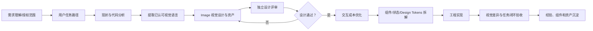
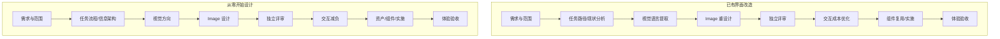
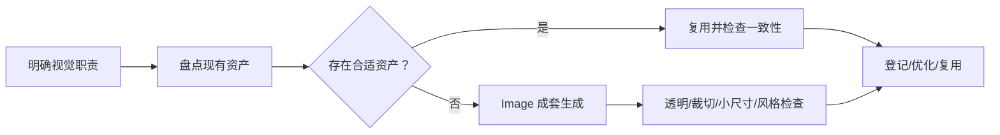
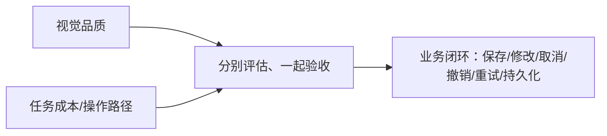

# Frontend Design Studio Skill 架构图（V1.4）

## 统一工作流

## 两种工作模式

## 视觉资产流水线

## 体验验收

## 治理原则

- 视觉丰富与操作简单分别设计、一起验收。
- 用户认可的视觉语言优先保护和延伸。
- 图片必须有品牌、信息或任务价值；没有合适资产时按规则调用 Image 生成。
- 减少操作不得牺牲可发现性、用户控制权、权限和业务安全。
- 尊重用户授权范围，不擅自扩大改造或部署。
